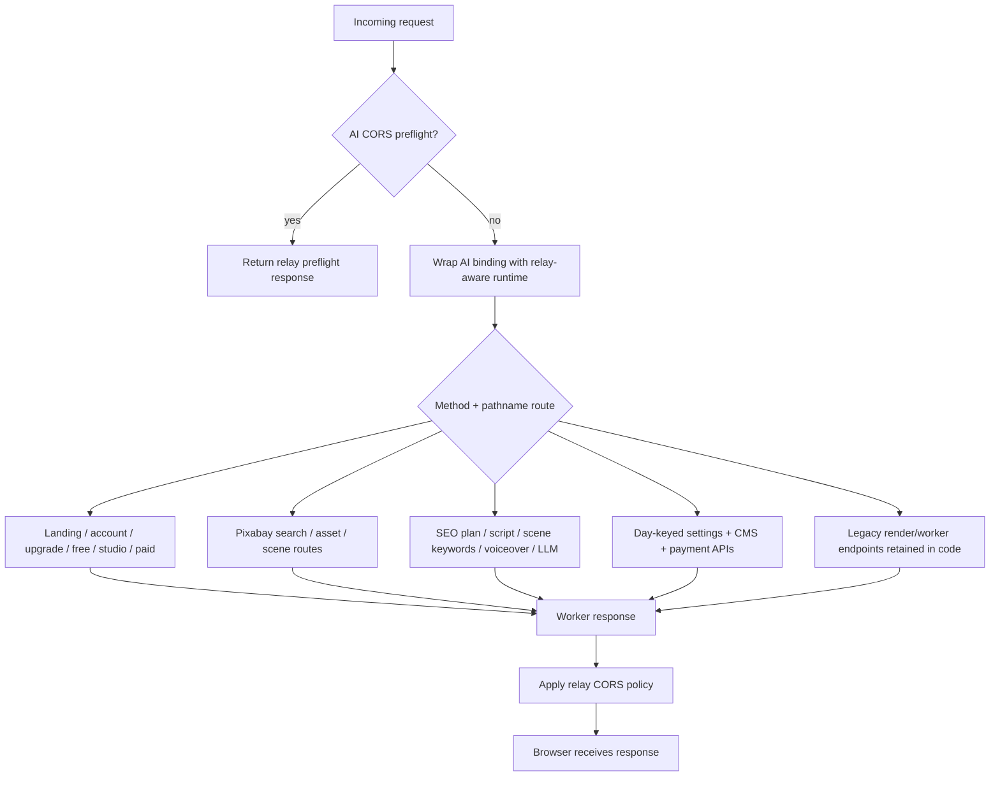
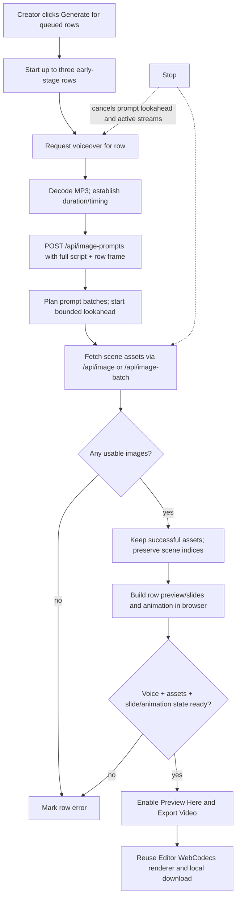
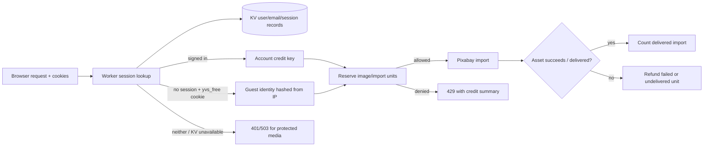
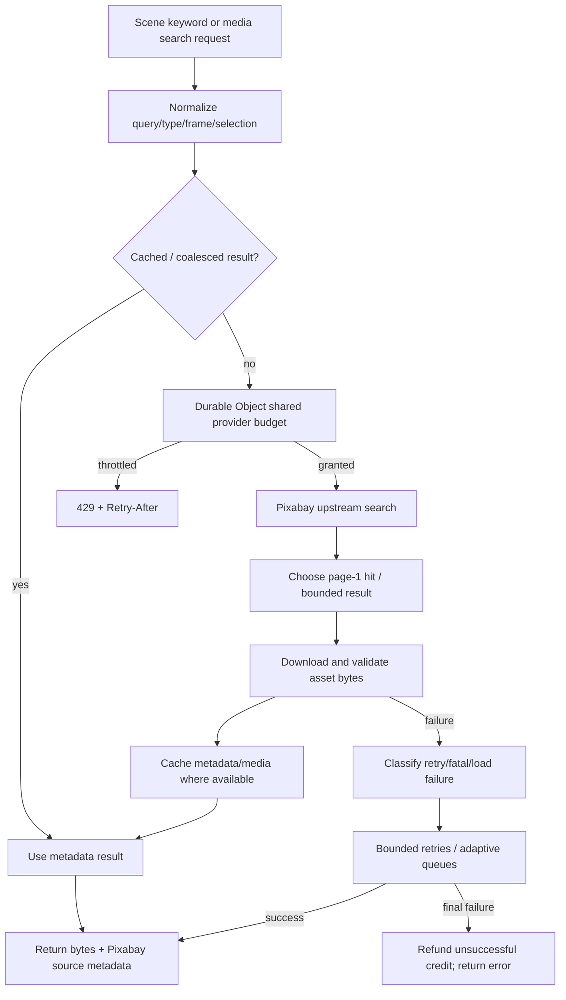
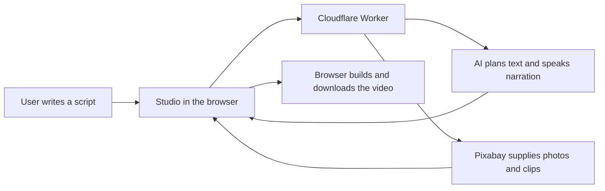

# System flow (derived from the current source)

This document describes the implementation in `src/` as it exists now. It is a code-oriented map of the running application—not a target design. The authoritative entry point is `src/index.ts`; the browser UI and pipelines live mainly in `src/client/`, and route-specific logic is split across `src/modules/`.

> **Current media policy:** scene planning produces short Pixabay search terms and the app imports real Pixabay photos/videos. It does not generate scene artwork with an image model. Some legacy names and comments still say “image generation” or “prompt”; those code paths now resolve stock media. See [`pixabay-media-migration.md`](pixabay-media-migration.md).

## 1. Runtime / component map

```mermaid
flowchart LR
    Visitor[Creator / visitor browser]
    Browser[Studio UI\nEditor + Quick Batch + templates]
    Local[Browser media & render pipeline\nWeb Audio + WebCodecs + MP4 muxer]
    Worker[Cloudflare Worker\nsrc/index.ts router]
    Relay[AI rotation / relay pool\nprimary + configured backup Workers]
    AI[Workers AI and/or OpenRouter\ntext, TTS, legacy-compatible AI binding]
    Pixabay[Pixabay API + CDN]
    KV[(Cloudflare KV\naccounts, sessions, credits, config, CMS, receipts)]
    DO[(Pixabay rate-limit Durable Object)]
    TTS[Configured fallback TTS provider]
    RenderApp[Optional standalone render-app\nNode + Playwright]

    Visitor --> Browser
    Browser <-->|same-origin HTTP APIs| Worker
    Browser -->|search + download media (browser-first)| Pixabay
    Worker -->|env.AI calls / relay selection| Relay
    Relay --> AI
    Worker -->|fallback search + download only| Pixabay
    Worker --> DO
    Worker <--> KV
    Worker -->|fallback audio request| TTS
    Browser -->|decode, compose, encode, download locally| Local
    Browser -. separate, optional process .-> RenderApp
```

### Main responsibilities

| Layer | Source | Responsibility |
| --- | --- | --- |
| Worker entry/router | `src/index.ts` | Request routing, relay/CORS wrapping, page assembly, account/credit checks, config and management route delegation. |
| Page/UI composition | `src/page.ts`, `src/client/markup.ts`, `src/client/styles.ts` | HTML shell, page markup and styles. Theme and plan mode are applied by the Worker before returning the page. |
| Browser app | `src/client/app-js.ts` and `src/client/*` | UI state, script/voiceover requests, media planning/import, project and Quick Batch state, local preview/export. |
| SEO/script | `src/modules/script-seo.ts` | SEO keyword-set planning and validated plain narration generation. |
| Script notes / async jobs | `src/modules/script-notes.ts`, `src/modules/script-notes-api.ts`, `src/modules/script-event-loop.ts` | Dynamic-URL keyed notes (research, keyword set, beat plan), deterministic keyword repair, and a Node-style phased event loop that can run a script job past the response. See [`current_code_latest.md`](current_code_latest.md). |
| Browser note memory | `src/client/script-notes-client.ts` | Keeps the note in `localStorage` (full) with a cookie mirror (compact) and an in-page map, so the plan travels with the script request (≈0.02 ms instead of a KV round trip). |
| Script hang guards | `src/modules/script-notes.ts` (`noteStaleReason`), `src/modules/script-notes-api.ts`, `src/client/app-js.ts` | Every async ticket is a promise that must end: queue-full runs inline or answers 503, a note whose isolate died is closed as `SCRIPT_NOTE_STALE` by the next reader, the page treats any `terminal` note as final, and it polls with a stall window and a wall-clock ceiling. One requester (`requestScriptWithNotes`) serves the editor accordion **and** the quick-batch table's ✨ script button. See `current_code_latest.md` §2b. |
| Pixabay image retries | `src/client/app-js.ts` (`retryImagePromptFlow`, `scheduleImageAutoRetry`, `probeMp4DurationWithRetry`) | Nothing in the media flow gives up on the first bad answer: a `429`/`Retry-After` is waited out (in-scene, 3 attempts), a stalled scene is aborted and re-armed on a fresh controller (90 s), a scene-batch that goes silent for 120 s is *planned* as a retry rather than a verdict, and the flow re-searches only the scenes still missing — at most twice, with a visible countdown. Clips get 3 probe attempts. A missing key / `401` / `403` / full gallery stays a verdict. See `current_code_latest.md` §2c. || Stock keyword planning | `src/modules/image-prompts.ts` | Turns the full narration into scene-by-scene Pixabay search keywords and the required photo/video scene mix. Despite the historical filename, this does not generate images. |
| Stock search/download | `src/modules/pixabay.ts` | Pixabay search, caching/coalescing, quota throttling, asset download and source metadata. |
| Scene asset transport | `src/modules/image-batch.ts` | Credit reservation, bounded/concurrent scene processing, retry/load behavior, streaming/binary transport and refunds for undelivered work. The compatibility name `runImageModel` delegates to Pixabay. |
| Voiceover | `src/modules/voiceover.ts` | Validates text/language, synthesizes speech in chunks, checks audio bytes, and uses the configured fallback path when needed. |
| Accounts/settings | `src/index.ts`, `src/modules/user-pages.ts`, `src/modules/payments.ts`, `src/modules/cms.ts` | Session/account screens, manual upgrade receipts, settings, CMS and persisted configuration. |
| API rotation | `src/modules/api-relay.ts`, `src/client/api-rotation.ts`, `src/client/browser-offload.ts` | Capability negotiation and routing AI requests across the primary/registered backup Workers; signed relay tickets protect cross-origin access. |

## 2. Request lifecycle and router



`GET /api/pipeline-capabilities` is a non-billable negotiation endpoint. Current response advertises pipeline version 261, binary image transport, chunked voiceover, API relay and Pixabay media, as well as image concurrency settings. `src/client/browser-offload.ts` uses those fields and retains compatibility fallbacks when a field is absent.

### Important route groups

- **Public pages:** `GET /`, `/account`, `/upgrade`, `/free`, `/studio`, `/paid`; `/signup` and `/login` redirect to account views. `/studio` requires a signed-in account; `/paid` requires a paid account; signed-out restricted visitors are sent to `/free`.
- **Session and credits:** `/api/session`, `/api/login`, `/api/signup`, `/api/logout`, `/api/credits` (implemented in `src/index.ts`).
- **SEO/script:** `POST /api/seo-plan`, `POST /api/script` (also `POST /api/script?async=1` → `202 {noteId, noteUrl}`), and the note resource `POST /api/script/notes`, `GET|DELETE /api/script/notes/<id>`. Notes reuse a validated keyword set + beat plan for the same dynamic URL/topic, and the async form lets the caller poll the note instead of holding the connection. Both are negotiated by the additive `scriptNotes`/`asyncScript` capability flags.
- **Media planning/import:** `POST /api/image-prompts`, `POST /api/image-batch`, `POST /api/image`; `GET /api/media/search`, `GET /api/media/asset`. `GET /image/<n>` is intentionally gone (410); older dynamic image-prompt job URLs return 410 because planning is a direct request/response, not a poll job.
- **Voice:** `POST /api/voiceover`; `GET /tts` is the server-side external TTS proxy.
- **Management:** day-specific `/<day>/config/uvxyz`, CMS routes, payment/receipt routes, relay routes and LLM route.
- **Legacy background rendering:** render/worker endpoints remain in source, but the current Editor and Quick Batch export paths render in the browser; they do not post completed projects to a server render queue.

## 3. Editor: script-to-video flow

```mermaid
sequenceDiagram
    actor Creator
    participant UI as Browser editor (app-js)
    participant Worker as Cloudflare Worker
    participant LLM as Text model via AI relay
    participant Pixabay as Pixabay API/CDN
    participant KV as KV credits/session
    participant Local as Browser Web Audio/WebCodecs

    Creator->>UI: Start SEO walkthrough / provide topic
    UI->>Worker: POST /api/seo-plan {topic}
    Worker->>LLM: Plan two SEO keyword sets
    LLM-->>Worker: Candidate sets
    Worker-->>UI: Validated sets (long-tail + 4 short terms, title/headings)
    Creator->>UI: Select keyword set + style / duration
    UI->>Worker: POST /api/script {selected keywordSet, inputs}
    Worker->>LLM: Write plain narration from selected plan
    LLM-->>Worker: Draft narration
    Worker->>Worker: Validate timing/keywords and return plain text
    Worker-->>UI: Script
    UI->>Worker: POST /api/voiceover (chunk-aware browser orchestration)
    Worker->>LLM: Synthesize chunks; fallback if needed
    LLM-->>Worker: Audio bytes
    Worker-->>UI: Audio bytes
    UI->>Local: Decode narration; audio is timing/master track
    UI->>Worker: POST /api/image-prompts {full script, duration, style, frame, batch}
    Worker->>LLM: Plan short stock search terms for requested scene slots
    LLM-->>Worker: Search terms with scene index/type
    Worker-->>UI: Search-term list (not generated artwork)
    loop Each scene / bounded chunks and lookahead
        UI->>Worker: POST /api/image or /api/image-batch {Pixabay selection, frame}
        Worker->>KV: Authorize and reserve stock-import credit(s)
        Worker->>Pixabay: Search photos/videos, then download selected asset
        Pixabay-->>Worker: Metadata + media bytes
        Worker->>KV: Refund failed or undelivered scene(s)
        Worker-->>UI: Binary bytes / streamed scene events + source metadata
        UI->>Local: Keep successful assets; retain partial results on later failures
    end
    Creator->>UI: Preview / Export
    UI->>Local: Compose images, clips, captions and narration; encode H.264/AAC; mux MP4
    Local-->>Creator: Local preview/download (or stream to disk where supported)
```

### Flow details visible in source

1. **SEO planning is optional.** The walkthrough asks for two selectable plans from `/api/seo-plan`. The selected plan is submitted to `/api/script`; the server validates the final narration against the plan. Script and voiceover usage counters are informational/unlimited rather than image-credit gates.
2. **Voiceover provides timing.** The browser requests chunked speech when supported. The Worker validates language/text and returns audio chunks; fallback TTS is available. The browser decodes the audio and uses its duration to lay out scenes/captions.
3. **Scene count is derived from script length.** The stock planner's canonical totals are 6 / 8 / 10 scenes based on word count (≤130 / ≤240 / above that, capped at 10); a smaller editor slot limit can reduce the requested total. Exactly two slots are videos, scene index 0 and `total - 2`; the other slots are photo images.
4. **Planner output is search vocabulary.** `/api/image-prompts` calls the text model with the entire script and asks for short (1–5 word) Pixabay search terms, not art prompts. Browser requests are batched and may look ahead while earlier scenes are being processed.
5. **Media bytes are fetched by the browser first.** `src/client/pixabay-direct.ts` validates the selection/frame, searches `pixabay.com` and downloads from `cdn.pixabay.com` using a short-lived config from `GET /api/media/config`. Import units are reserved with `POST /api/media/claim` and refunded for undelivered scenes with `POST /api/media/settle`. The Worker routes (`/api/image`, `/api/image-batch`, `/api/media/search`, `/api/media/asset`) remain as the per-scene fallback and for old clients. See [`IMAGE_FETCH_BROWSER_MIGRATION.md`](IMAGE_FETCH_BROWSER_MIGRATION.md) for the verified flow and debug guide.
6. **Rendering stays in the browser.** The editor uses browser decode/canvas/WebCodecs facilities and `mp4-muxer` to produce the MP4; it is not a server-rendering workflow. The narration track remains the master audio.

## 4. Quick Batch flow

Quick Batch is a second UI entry point but reuses the same Worker APIs and browser renderer. It supports up to 10 rows. Each row carries script, style, duration, resolution and orientation.



- Per-row resolution/orientation are passed to both prompt planning and media selection so preview and import agree on the output frame.
- Successful rows are skipped on a later Generate click; a partial row keeps usable media rather than automatically replaying/billing completed assets.
- Up to three rows enter early generation concurrently; image work is further bounded by browser/server queues and capability-negotiated slots.

## 5. Identity, authorization, credits and persisted state



- Account records and credit counters are stored in KV; guest stock-import counters are keyed from a salted hash of the visitor IP. The guest browser entry route `/free` sets the `yvs_free` cookie, but the server-side counter—not browser local storage—authorizes stock imports.
- Image/stock-import quotas are enforced server-side. Local browser usage history is display-only. Pixabay's own rate limit is separate from the app's account/guest allowance.
- If KV is absent, protected media access is closed unless the explicit local/testing flag `PIXABAY_ALLOW_UNMETERED=true` is set. A failed credit authorization does not silently grant a media import.
- Settings are served only at the current day-prefixed route, using Asia/Taipei day formatting. The settings page manages theme, API relay, provider/configuration, guest/account credits, payments and CMS data, subject to its own authorization.

## 6. Pixabay request pipeline and resilience



The Pixabay module requests three results upstream (provider minimum), returns at most two photo choices or three video choices, limits current search to page 1, validates provider URLs and media signatures, and uses a shared Durable Object budget when configured. Search cache/coalescing reduces duplicate work. The image task queue and load governor bound concurrency; overload responses expose retry timing so the browser can wait rather than immediately adding load.

## 7. Other paths in the repository

- **Accounts:** signup/login/session lookup is KV-backed; account pages route free users to `/studio` and paid users may access `/paid`.
- **Manual upgrade workflow:** a user uploads a payment receipt; an administrator reviews and approves it through settings. This is not an automated payment-provider checkout.
- **CMS:** administrators create/update/delete bounded public pages in KV; the Worker inserts CMS navigation links into shared page HTML and serves escaped public content.
- **Templates:** template composition/editing is browser-side (`template-composer-js.ts`, scene editor and carousel modules). Resulting assets/state flow back into the studio's local renderer.
- **Optional `render-app/`:** independent Node/Playwright TTS utility. It is not part of the Cloudflare Worker request path or the studio's MP4 export path.

## 8. Source pointers

- Router and page/credit/auth helpers: `src/index.ts`
- Main browser application and local MP4 rendering: `src/client/app-js.ts`
- Browser request/capability layer: `src/client/browser-offload.ts`
- SEO planner/script validation: `src/modules/script-seo.ts`
- Script-wide Pixabay keyword planning and scene sizing: `src/modules/image-prompts.ts`
- Pixabay search/download/rate limiting: `src/modules/pixabay.ts`
- Stream/binary transport and image-credit refunds: `src/modules/image-batch.ts`
- Voice synthesis and fallback: `src/modules/voiceover.ts`
- Relay/API rotation: `src/modules/api-relay.ts`, `src/client/api-rotation.ts`
- Current media policy and limits: `pixabay-media-migration.md`
- Product behavior/system constraints: `system-rules.md`

## 9. User flow, explained simply (with code functions)

### Editor walkthrough

1. **Open the studio and start the SEO walkthrough.** The Worker serves the page through `appPageResponse()` in `src/index.ts`. The browser's `generateScript(n)` opens the walkthrough and requests keyword ideas from `POST /api/seo-plan`.
2. **Choose the keyword idea and visual style.** `selectSeoKeywordSet(n, idx)` saves the user's selection; `confirmSeoStyleAndGenerate(n)` continues when both choices are ready.
3. **Get the narration.** The browser's `runSeoScriptRequest()` calls `requestSeoScriptOnce()`, which sends `POST /api/script`. The Worker delegates to `handleSeoScriptGeneration()` in `src/modules/script-seo.ts` and returns validated narration text.
4. **Plan and import stock scenes.** `startImagePromptFlow(n)` calls `runProgressiveImagePipeline()` in `src/client/progressive-image-pipeline.ts`. It requests Pixabay search terms from `POST /api/image-prompts`; the Worker handles that with `handleGenerateImagePrompts()`. It then sends scene selections to the media routes, which authorize credits and import media from Pixabay. `handleImageBatch()` / `handleImageBinary()` in `src/modules/image-batch.ts` return the media; the browser adds successful photos and clips to the gallery and keeps usable partial results if a later scene fails.
5. **Make the video.** The user previews or exports using the browser renderer, including `generateMP4()` in `src/client/app-js.ts`. WebCodecs and the MP4 muxer create the file locally; the Worker does not render the final video.

In short: **`generateScript` → `selectSeoKeywordSet` → `confirmSeoStyleAndGenerate` → `requestSeoScriptOnce` → `startImagePromptFlow` → `generateMP4`.**

### Quick Batch

The user enters a script in a row and clicks Generate. `generateBatchRows()` starts row work; `requestBatchVoiceover()` creates the narration audio, `requestBatchPrompts()` asks for scene search terms, and the row's image request imports the Pixabay media. Once row assets are ready, **Preview Here** and **Export Video** use the same browser-side renderer (`exportBatchRow()` for export).

## 10. Oversimplified version



In one line: **write script → plan stock searches → get Pixabay media + narration → build the video in your browser.**
